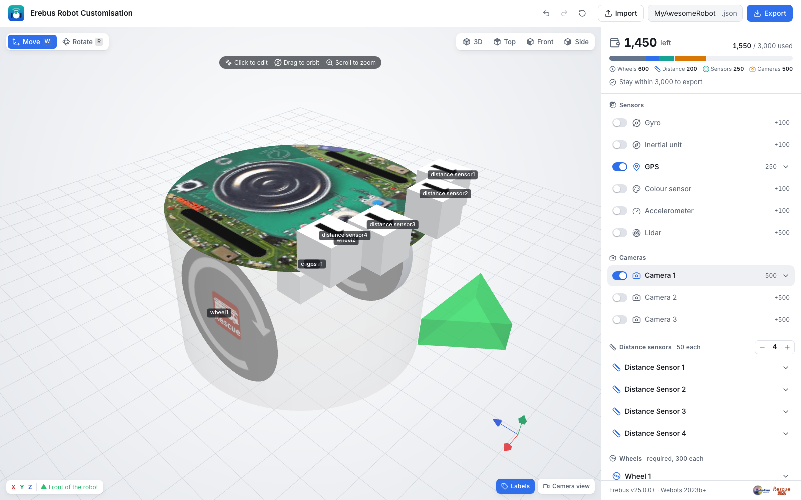

<p align="center"></p>

# Erebus Robot Customisation

Robot customiser and generator for RoboCupJunior Rescue Simulation (Erebus).
Works with Erebus v25.0.0+ and Webots 2023b+.

**Open the app: <https://robot.erebus.rcj.cloud>**



## Features

- Add sensors and place them in 3D, with the gizmo or with exact values
- See what is left of the budget, and what a sensor would cost before adding it
- Point a sensor in a direction with one click
- Name components for use in your controller
- Undo and redo, and automatic saving of your work in the browser
- Import and export robot files, also by dropping a file onto the page
- In 12 languages, chosen from the browser's language or from the menu at the bottom right
  (add `?lang=ja` to a link to open it in a language)

### Components

- Gyro, inertial unit, GPS, colour sensor, accelerometer, lidar
- Cameras (x3), each with its own resolution
- Distance sensors (up to 8)
- Wheels (x2) with rotation sensors

### Shortcuts

| Key | Action |
| --- | --- |
| `W` / `R` | Move / rotate with the gizmo |
| `Esc` | Close the selected component |
| `Ctrl/⌘ Z` | Undo |
| `Ctrl/⌘ Shift Z` | Redo |

## Development

Requires Node.js 22.12 or later.

```sh
npm install
npm run dev
```

| Command | Description |
| --- | --- |
| `npm run dev` | Start the dev server |
| `npm run build` | Type-check and build to `dist/robot-customisation` |
| `npm run preview` | Serve the production build |
| `npm test` | Run the unit tests |
| `npm run test:e2e` | Run the browser tests (first run `npx playwright install chromium`) |

Built with [Vite](https://vite.dev), [React](https://react.dev), TypeScript and [three.js](https://threejs.org).

## Translations

Text is in `src/i18n/messages`, one file per language, with English in `en.ts`. Text a
language leaves out is shown in English. Keep the `{placeholders}`; `npm test` checks them.

## Robot file format

Erebus reads the exported JSON, so the keys and field names in `src/robot` must stay as they are.
`e2e/fixtures` holds files exported by the previous version of this app, and
`e2e/compatibility.spec.ts` checks that exports still match them.

## Copyright

© 2020–2026 Erebus Development Team
